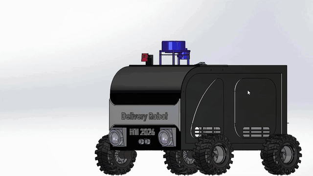

# Autonomous Delivery Robot System

<div align="center">
  
  
  
  
  
  
</div>

<br />

> **A state-of-the-art indoor delivery solution integrating autonomous mobile robotics, advanced AI perception, and a seamless mobile user experience.**

<p align="center">
  <a href="https://lnkd.in/p/ejVc_kCz">
    
  </a>
  <br>
  <sub>Mechanical design preview (SolidWorks). Click the animation to watch the full demo on LinkedIn.</sub>
</p>

## Table of Contents

- [Overview](#overview)
- [Key Features](#key-features)
- [System Architecture](#system-architecture)
- [AI Chatbot Assistant (Rafiq)](#ai-chatbot-assistant-rafiq)
- [Live Dashboard](#live-dashboard)
- [Getting Started](#getting-started)
- [Usage Guide](#usage-guide)
- [Repository Structure](#repository-structure)
- [Technical Details](#technical-details)
- [Future Improvements](#future-improvements)
- [Contributors](#contributors)
- [Acknowledgments](#acknowledgments)

---

## Overview

The **Autonomous Delivery Robot System** is a sophisticated mechatronics project designed to automate indoor logistics (labs, offices, cafeterias). Built upon the **Andino** robot platform and powered by **ROS 2 Humble**, this system features a fully autonomous navigation stack, a dedicated **Android mobile application** for control and ordering, and an intelligent **AI interaction layer** that uses Computer Vision to verify recipients and confirm successful deliveries via natural hand gestures.

Watch the full project demo on [LinkedIn](https://lnkd.in/p/ejVc_kCz).

---

## Key Features

### Smart Mobile App Integration
A native Android application serves as the command center for the robot:
*   **Order Creation**: Intuitive UI to select destinations (Lobby, Lab, Library, Cafeteria).
*   **Manual Control**: Virtual joystick for teleoperation with adjustable speed.
*   **Live Dashboard**: Real-time status updates, order history, and connection health.
*   **Live Streaming**: View the robot's camera feed directly on the phone.
*   **AI Chatbot**: Built-in assistant to answer questions about the robot's capabilities.

### Intelligent Perception & Interaction
The robot goes beyond simple navigation with advanced AI modules:
*   **Gesture Recognition (YOLO)**: Fine-tuned YOLO model detects a **"Thumbs Up" (Like)** gesture to confirm order receipt, triggering the robot's automatic return to home.
*   **Secure Verification (QR)**: The specific recipient is verified by scanning a dynamic **QR Code** generated by the mobile app upon arrival.
*   **Obstacle Avoidance**: Fuses data from **Lidar** and **Ultrasonic sensors** to navigate safely around static and dynamic obstacles.

### Autonomous Operations
*   **Nav2 Navigation**: Uses SLAM for mapping and the ROS 2 Navigation Stack for path planning and localization.
*   **Auto-Return**: Automatically returns to the home position after delivery confirmation (autonomous self-docking is planned, see Future Improvements).

---

## System Architecture

The project is divided into three main layers:

### 1. Robot Layer (ROS 2)
*   **`andino_gz`**: High-fidelity simulation in Gazebo.
*   **`andino_description`**: This package acts as the robot's **"Digital Anatomy"**. It explains the physical structure to the software so the robot understands its own body.
    *   **The Parts (Links)**: It lists every physical piece, like the chassis (body), left wheel, right wheel, and camera.
    *   **The Movement (Joints)**: It defines how these parts connect and move. For example, it specifies that the "Wheels" can spin around an axle, but the "Camera" is stuck firmly to the chassis.
    *   **The Logic (Transforms)**: This allows the robot to know math like: *"If my camera sees a door 1 meter away, and my camera is 10cm in front of my wheels, then my wheels are 1.1 meters away from the door."* Without this, autonomous navigation is impossible.
*   **`navigation_configs`**: Nav2 parameters, behavior trees, and maps.
*   **`deliverybot_bringup`**: Launch files to start the entire stack.

#### Andino Package Architecture

```
┌─────────────────────────────────────────────────────────────────────────┐
│                        ANDINO ROBOT STACK                               │
├─────────────────────────────────────────────────────────────────────────┤
│                                                                         │
│  ┌─────────────────┐     ┌─────────────────┐     ┌───────────────────┐  │
│  │ andino_firmware │────▶│   andino_base   │────▶│ andino_description│  │
│  │    (Arduino)    │     │ (ROS 2 Driver)  │     │   (URDF/Xacro)    │  │
│  │  Motor + Encoder│     │   Odometry      │     │   Robot Model     │  │
│  └─────────────────┘     └─────────────────┘     └────────┬──────────┘  │
│                                                           │             │
│                                                           ▼             │
│  ┌─────────────────┐     ┌─────────────────┐     ┌───────────────────┐  │
│  │   andino_slam   │◀───▶│andino_navigation│◀────│  andino_bringup   │  │
│  │ (slam_toolbox)  │     │     (Nav2)      │     │  (Launch Files)   │  │
│  │  Map Building   │     │  Path Planning  │     │  System Startup   │  │
│  └─────────────────┘     └────────┬────────┘     └───────────────────┘  │
│                                   │                                     │
│                                   ▼                                     │
│                          ┌─────────────────┐                            │
│                          │ andino_control  │                            │
│                          │(diff_drive_ctrl)│                            │
│                          │   /cmd_vel      │                            │
│                          └─────────────────┘                            │
│                                                                         │
└─────────────────────────────────────────────────────────────────────────┘
```

### 2. AI & Application Layer
*   **`yolo_like_detector`**: Python node running the specific gesture recognition model.
*   **`qr_verification`**: Handles camera input for QR decoding and validation.
*   **`map_info`**: Manages map metadata for the application.

### 3. User Interface Layer (Android)
*   **`DeliveryBotApp`**: Communicates with ROS 2 via `rosbridge_suite` (WebSocket).
*   **Features**: WebSocket client (`ws://<ROBOT_IP>:9090`), MJPEG stream viewer, and chat interface.

---

## AI Chatbot Assistant (Rafiq)

The robot features a sophisticated **AI-powered conversational assistant** named **Rafiq (رفيق)** that provides natural language interaction in both **Arabic and English**. This is not a simple scripted chatbot—it's a fully integrated AI system with voice capabilities and real-world robot control.

### Core AI Components

| Component | Technology | Description |
| :--- | :--- | :--- |
| **LLM Brain** | `llama_ros` + [llama.cpp](https://github.com/ggerganov/llama.cpp) | Runs quantized GGUF language models locally for intelligent responses |
| **Speech-to-Text** | `whisper_ros` + [whisper.cpp](https://github.com/ggerganov/whisper.cpp) | Offline speech recognition with Silero VAD (Voice Activity Detection) |
| **Text-to-Speech** | `piper_ros` + [Piper](https://github.com/rhasspy/piper) | High-quality offline voice synthesis |
| **State Machine** | `yasmin` | Controls chatbot conversation flow and multi-step interactions |
| **Chat Bridge** | `chat_bridge.py` | Central ROS 2 node connecting mobile app ↔ AI ↔ Robot commands |

### Architecture Diagram

```
┌─────────────────────────────────────────────────────────────────────────┐
│                          CHATBOT SYSTEM                                 │
├─────────────────────────────────────────────────────────────────────────┤
│                                                                         │
│   ┌───────────────┐        ┌───────────────────┐        ┌─────────────┐│
│   │  Mobile App   │◀──────▶│   Chat Bridge     │◀──────▶│  Llama LLM  ││
│   │  (Android)    │ JSON   │   (ROS 2 Node)    │ Action │  (llama.cpp)││
│   └───────────────┘        └─────────┬─────────┘        └─────────────┘│
│                                      │                                  │
│                    ┌─────────────────┼─────────────────┐                │
│                    ▼                 ▼                 ▼                │
│            ┌─────────────┐   ┌─────────────┐   ┌─────────────┐          │
│            │  Navigation │   │   YOLO      │   │   TTS       │          │
│            │  Commands   │   │   Vision    │   │   (Piper)   │          │
│            └─────────────┘   └─────────────┘   └─────────────┘          │
│                                                                         │
└─────────────────────────────────────────────────────────────────────────┘
```

### Key Capabilities

*   **🌐 Bilingual Support**: Responds in Arabic with English translation (format: `عربي ||| English`).
*   **🗺️ Navigation Commands**: Understands "Go to Kitchen" → `[COMMAND: Kitchen]` → Robot moves.
*   **🎮 Motion Control**: Commands like "Move forward" → `[ACTION: FORWARD]` with LIDAR safety checks.
*   **📊 Analytics Queries**: "How many deliveries today?" → Reads CSV logs and provides statistics.
*   **👁️ Vision Awareness**: Integrates YOLO detections to answer "What do you see?".
*   **📸 Camera Snapshots**: Can send live camera images to the mobile app on request.
*   **😂 Personality**: Built-in jokes, playful responses, and a friendly robot persona.

### ROS 2 Topics

| Topic | Type | Direction | Description |
| :--- | :--- | :--- | :--- |
| `/app/chat/request` | `std_msgs/String` | Subscribe | User messages from mobile app |
| `/app/chat/response` | `std_msgs/String` | Publish | AI responses (JSON: text + voice) |
| `/llama/generate_response` | Action | Client | Sends prompts to LLM |
| `/say` | Action | Client | Text-to-Speech output |
| `/app/goal_name` | `std_msgs/String` | Publish | Navigation commands |
| `/cmd_vel` | `geometry_msgs/Twist` | Publish | Direct motion control |

### Model Setup

The chatbot launch file selects these models and repositories:

- **LLM:** `Qwen/Qwen2.5-Coder-3B-Instruct-GGUF`, file `qwen2.5-coder-3b-instruct-q4_k_m.gguf`.
- **Whisper:** `ggerganov/whisper.cpp`, file `ggml-small.bin`, configured for Arabic transcription.
- **Piper voice:** `rhasspy/piper-voices`, voice `en/en_US/lessac/medium/en_US-lessac-medium.onnx` with matching `en/en_US/lessac/medium/en_US-lessac-medium.onnx.json` configuration.

The launch files use Hugging Face repository names and filenames; they download or resolve the model files through the ROS packages rather than defining a repository-local model directory. The `chat_bridge.py` bridge does not specify model paths.

---

## Live Dashboard

A real-time **analytics dashboard** built with **Streamlit** that automatically synchronizes with the robot and provides comprehensive monitoring of all delivery operations.

### Dashboard Features

*   **🔄 Auto-Sync**: Dashboard automatically refreshes every 5 seconds to stay synchronized with live robot data.
*   **📦 KPI Metrics**: Total orders, success rate, top destination, average trip duration.
*   **📈 Interactive Charts**: Orders over time, status distribution (pie chart), hourly volume analysis.
*   **📋 Activity Log**: Recent deliveries with status highlighting.
*   **📅 Custom Date Range**: Filter data by Today, Last Week, Last Month, Last Year, or **any custom date range**.
*   **📥 Export Options**: 
    - **CSV Download**: Export filtered data for any selected time period.
    - **PDF Reports**: Generate professional PDF reports with charts for any custom date range.

### Technology Stack

| Package | Version | Purpose |
| :--- | :--- | :--- |
| `streamlit` | Latest | Web dashboard framework |
| `pandas` | Latest | Data manipulation and analysis |
| `plotly` | Latest | Interactive charts and graphs |
| `matplotlib` | Latest | Static chart generation for PDF |
| `fpdf` | Latest | PDF report generation |
| `jinja2` | Latest | Template rendering |

### Dashboard Screenshots

The dashboard displays:
- **Header**: Robot logo and title "Autonomous Delivery Dashboard"
- **Sidebar**: Time period filters (Today, Last Week, Last Month, Custom Range)
- **Main Panel**: 4 KPI cards → Time series chart → Pie chart → Busy hours analysis → Data table
<!-- TODO: add screenshots to docs/ and reference them here -->

### Running the Dashboard

```bash
# Install dependencies
pip install -r src/App/order_logger/dashboard/requirements.txt

# Launch the dashboard
cd src/App/order_logger/dashboard
streamlit run dashboard.py
```

The dashboard automatically reads from `delivery_log.csv` which is populated by the order logging system during robot operations.

---

## Getting Started

### Prerequisites
*   **Ubuntu 22.04 LTS**
*   **ROS 2 Humble Hawksbill**
*   **Gazebo Fortress** or **Ignition**
*   **Android Studio** (for app development)

### Installation

1.  **Clone the Repository**
    ```bash
    cd ~
    git clone https://github.com/BN-Nasser/Autonomous-Delivery-Robot.git
    mv Autonomous-Delivery-Robot ws
    cd ws
    ```

2.  **Install Dependencies**
    ```bash
    cd ~/ws
    rosdep install --from-paths src --ignore-src -r -y
    pip install -r requirements.txt  # For YOLO, OpenCV, etc.
    ```

3.  **Build the Workspace**
    ```bash
    colcon build --symlink-install
    source install/setup.bash
    ```

### Building the Android App

The Android project is in `mobile/DeliveryBotApp`. It uses Gradle, Android Gradle Plugin `8.5.2`, and Kotlin Android Plugin `1.9.24`. The app targets Android SDK `34`, has a minimum SDK of `24`, and sets the Java/Kotlin compatibility level to `17`.

Open `mobile/DeliveryBotApp` in Android Studio or build the app with:

```bash
cd mobile/DeliveryBotApp
./gradlew assembleDebug
```

The verified Gradle configuration produces a debug APK for application ID `com.example.deliverybot` and enables AndroidX and Jetifier.

---

## Usage Guide

<details>
<summary>Simulation Mode (Gazebo & Office World)</summary>

Run the following commands in separate terminals to start the full simulation stack.

**Terminal 1: Launch Simulation & Navigation**
Starts Gazebo with the office world, RViz, and the Nav2 stack.
```bash
cd ws
ros2 launch andino_gz andino_gz.launch.py nav2:=True world_name:=office.sdf map:=office
```

**Terminal 2: Map Locations Visualization**
Displays saved locations on the map and enables adding new points via RViz ("Publish Point").
```bash
cd ws
ros2 run map_info goal_name --ros-args -p enable_click_input:=true
```

**Terminal 3: Locations Manager CLI**
A menu to delete saved locations or send the robot to a specific named point directly from the terminal.
```bash
cd ws
ros2 run map_info go_menu
```

**Terminal 4: Mobile App Bridge**
Starts the application backend server to allow the Android app to connect to the robot.
```bash
cd ws
./app
```

**Terminal 5: AI Chatbot Assistant**
Launches the Rafiq AI chatbot with LLM and voice capabilities.
```bash
cd ws
./chat
```

</details>

---

<details>
<summary>Real Robot Operation</summary>

Follow these steps to run the software on the physical Andino robot.

**Terminal 1 (SSH into Raspberry Pi): Robot Drivers**
Initializes the robot's hardware interfaces and core drivers.
```bash
cd ws
ros2 launch andino_bringup andino_robot.launch.py
```

**Terminal 2 (Laptop): Visualization**
Launches RViz on your remote computer to see what the robot sees.
```bash
cd ws
ros2 launch andino_bringup rviz.launch.py
```

**Terminal 3 (Laptop): Manual Control**
Enables teleoperation to drive the robot using the keyboard.
```bash
cd ws
ros2 launch andino_bringup teleop_keyboard.launch.py
```

**Terminal 4 (Laptop): Navigation Stack**
Starts the autonomous navigation system using the pre-built `HTI` map.
```bash
cd ws
ros2 launch andino_navigation bringup.launch.py map:=HTI.yaml
```

**Terminal 5 (Laptop): Map Locations Visualization**
Displays saved locations and enables adding new points via RViz.
```bash
cd ws
ros2 run map_info goal_name --ros-args -p enable_click_input:=true
```

**Terminal 6 (Laptop): Locations Manager CLI**
Menu to manage locations or send the robot to a specific point.
```bash
cd ws
ros2 run map_info go_menu
```

**Terminal 7 (Laptop): Mobile App Bridge**
Starts the backend server for the mobile app connection.
```bash
cd ws
./app
```

**Terminal 8 (Laptop): AI Chatbot Assistant**
Launches the Rafiq AI chatbot with LLM and voice capabilities.
```bash
cd ws
./chat
```

</details>

---

## Repository Structure

```text
.
├── map/              # Saved ROS 2 navigation maps and map metadata
├── mission_proof/    # Mission evidence and dated proof assets
├── mobile/           # Android app project and prebuilt app APK
├── src/              # ROS 2 packages and application components
├── test/             # Hardware, sensor, and integration test scripts
├── app               # Executable launcher for the application backend
├── chat              # Executable launcher for the Rafiq chatbot stack
├── install_deps.sh   # Project dependency installation script
├── requirements.txt  # Python dependencies
└── docs/             # Project documentation assets
```

---

## Technical Details

| Component | Technology | Description |
| :--- | :--- | :--- |
| **SLAM** | `slam_toolbox` | Real-time mapping and localization |
| **Path Planning** | `Nav2` (A*) | Dynamic pathfinding with costmaps |
| **Vision** | `YOLOv8` + `OpenCV` | Object detection and image processing |
| **Communication** | `rosbridge_suite` | JSON-based WebSocket bridge for app control |
| **Video Stream** | `web_video_server` | Low-latency MJPEG streaming over HTTP |
| **Simulation** | `Gazebo` + `Rviz2` | Physics simulation and visualization |


---

## Future Improvements

We are constantly working to enhance the capabilities of the Autonomous Delivery Robot. The following features are planned for future updates to improve performance, adaptability, and user experience.

### Hardware Upgrades
*   **Ultrasonic 360° Coverage**: Expanding the sensor array to eliminate blind spots and ensure complete safety in complex environments.
*   **GPS Module Integration**: Enabling outdoor navigation capabilities to allow the robot to operate between buildings or in open campus areas.
*   **Real-time Battery Monitoring (BMS)**: Implementing a hardware-based Battery Management System to provide accurate voltage and current readings, replacing the current simulated model for better power management.
*   **Automatic Charging (Self-Docking)**: Implementing a system for the robot to autonomously locate and connect to its charging station when battery levels are low, ensuring continuous operation without manual intervention.

### System Extensions
*   **Multi-Floor Navigation**: Integrating with elevator IoT systems to allow the robot to traverse different floors autonomously.
*   **Wake-Word Detection**: hands-free activation for the Rafiq voice assistant (speech recognition and synthesis are already supported offline).
*   **Cloud Dashboard**: A web-based remote monitoring platform to view robot status, camera feeds, and analytics from anywhere over the internet.

---

## Contributors

**Development Team - HTI Mechatronics**
<table align="center" width="100%">

  <!-- ================= SOFTWARE TEAM ================= -->
  <tr>
    <th colspan="2" align="center">
      <h2> Software Team</h2>
    </th>
  </tr>

  <tr>
    <td width="70%"><b>Mohammed Nasser Abdelhady</b></td>
    <td width="30%" align="center">
      <a href="https://www.linkedin.com/in/mohamed-nasser-7857702b2/">
        
      </a>
    </td>
  </tr>

  <tr>
    <td><b>Abdulrahman Muhammad Muhammad</b></td>
    <td align="center">
      <a href="https://www.linkedin.com/in/abdalrahmanabouelnaga">
        
      </a>
    </td>
  </tr>

  <tr>
    <td><b>Jack Isaac Boshra</b></td>
    <td align="center">
      <a href="https://www.linkedin.com/in/jackoviic">
        
      </a>
    </td>
  </tr>

  <tr>
    <td><b>Reem Sayed Saad</b></td>
    <td align="center">
      <a href="https://www.linkedin.com/in/reem-sayed-07402b264">
        
      </a>
    </td>
  </tr>

  <!-- ================= MECHANICAL TEAM ================= -->
  <tr>
    <th colspan="2" align="center">
      <h2> Mechanical Team</h2>
    </th>
  </tr>

  <tr>
    <td><b>Kareem Ahmed Taha</b></td>
    <td align="center">
      <a href="https://www.linkedin.com/in/karim-ahmed-657307263">
        
      </a>
    </td>
  </tr>

  <tr>
    <td><b>Seif Ayman Hassan</b></td>
    <td align="center">
      <a href="https://www.linkedin.com/in/seif-ayman-a98028384">
        
      </a>
    </td>
  </tr>

  <tr>
    <td><b>Eslam Tohamy Shaaban</b></td>
    <td align="center">
      <a href="https://www.linkedin.com/in/eslam-tohamy">
        
      </a>
    </td>
  </tr>

</table>


<br />

## Acknowledgments

We would like to express our sincere gratitude to our project supervisors for their invaluable guidance and support throughout this journey.

<table align="center">
  <tr>
    <td align="center"><b>Prof. Dr. Amal Ibrahim</b></td>
    <td align="center"><b>Dr. Ahmed El-Sayed</b></td>
  </tr>
</table>

---
<div align="center">
  <sub>Created for HTI Mechatronics Graduation Project</sub>
</div>
